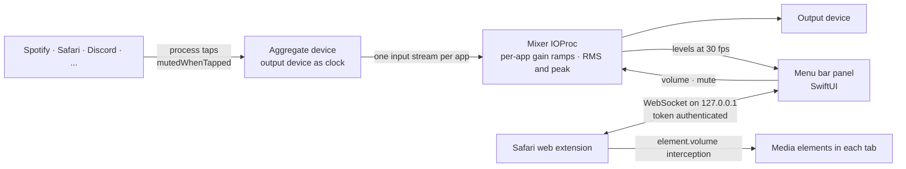

<div align="center">

  # PerAppVolume

  **Per-app and per-tab volume control for macOS, from the menu bar.**

  The volume control macOS never shipped: one slider for every app that is making sound, plus one slider for every browser tab, in a panel that lives next to the clock and starts with your Mac.

  [](https://swift.org)
  [](https://developer.apple.com/xcode/swiftui/)
  [](https://developer.apple.com/documentation/coreaudio)
  [](https://developer.apple.com/documentation/safariservices/safari_web_extensions)
  [](https://www.apple.com/macos)
  [](LICENSE)
</div>

---

## What is PerAppVolume?

macOS only exposes one master volume. If a meeting is too loud while a video is too quiet, your only option is to hunt for the volume control inside each app, and browsers do not even have one per tab.

PerAppVolume fixes that at two levels. At the system level it uses Core Audio process taps to intercept the audio of every running app, apply its own gain and feed it back to your output device, with no kernel extension and no virtual audio driver. At the browser level a Safari web extension takes control of the media elements inside each tab, so a Google Meet call and a YouTube video in the same browser get independent sliders.

Everything runs locally. Audio is never recorded or sent anywhere; it passes through a mixer in memory and leaves immediately.

---

## Highlights

| | |
| --- | --- |
| **One slider per app** | Every app that is playing audio gets a row with its real icon, a volume capsule and a mute toggle. Volumes are remembered per app. |
| **One slider per browser tab** | Tabs that are playing audio appear nested under Safari with their favicon and title. Lowering a tab lowers only that tab. |
| **Live meters inside the controls** | The fill of each capsule is the live level of that app after your adjustment, so you see the audio you hear. The app icon glows in its own dominant color while it plays. |
| **No driver, no restart** | Built on the process tap API that ships with macOS. Nothing is installed in the audio stack, nothing survives a crash of the app. |
| **Constant pipeline** | An app is tapped the moment it starts emitting sound, at gain 1.0. Touching a slider only changes a number, so there is never a gap or a latency jump mid-playback. |
| **Trackpad native** | Scroll with two fingers over a row to adjust it, double click a capsule to reset it to 100 percent, click the icon to mute. |
| **Output device switching** | The chip at the top shows the current output and switches between headphones, speakers and displays. |
| **Starts with your Mac** | A single toggle in Settings registers the app as a login item. |

---

## How It Works



### The audio engine

`AudioEngine` is a Swift package with no dependencies beyond the system frameworks.

- **Process registry.** Observes the Core Audio process object list and the `IsRunning` property of each process. Helper processes are grouped under their parent app, so Chrome, Slack and WebKit content processes collapse into one row.
- **One tap per app, one aggregate device for all.** Each app group gets a `CATapDescription` covering all of its processes with `mutedWhenTapped`, which silences the original output. All taps join a single private aggregate device whose clock is the real output device, with drift compensation enabled. Adding or removing an app updates the tap list on the live device; a full rebuild only happens when the output device changes, with a short fade on both sides.
- **The mixer.** A single IOProc reads one input stream per tap, applies a per-app gain with a 10 ms linear ramp to avoid zipper noise, sums into the output buffer and measures RMS and peak per app with vDSP. The UI reads those meters through lock-free fields at 30 fps.
- **Lifecycle.** Orphaned aggregate devices from a previous crash are destroyed at launch. Sleep tears the pipeline down and wake rebuilds it with retries. Bluetooth outputs get a larger buffer. The system audio recording permission is requested on a dedicated queue so the panel stays responsive while the dialog is open.
- **Exclusions.** Digital audio workstations and players with protected content are never intercepted; the list is a plain set of bundle identifiers.

### Per-tab volume in Safari

Browsers mix all of their tabs into one process before the audio reaches the system, so tabs can only be separated from inside the browser.

- A content script injected into the page's own JavaScript world redefines the `volume` property of `HTMLMediaElement`, intercepts `play()` and `srcObject` assignments, and multiplies whatever volume the site sets by the gain of that tab. The site keeps believing it owns the volume. Elements that are never attached to the DOM, as in Google Meet, are still caught.
- The background script keeps a registry of audible tabs, reconnects to the app with backoff, and reports which tabs it could actually take control of. A tab the page refuses to hand over shows a warning in the panel instead of a slider that does nothing.
- The app runs a tiny WebSocket server on the loopback interface. The extension authenticates with a token generated at build time and shared only between the app and the extension embedded in it. Connections without the token are closed on the first message.
- Effective volume of a tab is the tab gain times the Safari gain, so the browser row acts as the master for its tabs.

---

## The Panel

The panel is a 340 pt window on dark glass. From top to bottom:

1. **Master.** System volume and the output device chip.
2. **Playing apps.** Icon with a glow that breathes with the level, name, state label, capsule slider with the live meter inside it, percentage in tabular digits.
3. **Tabs.** Nested under their browser with favicon, title and a smaller capsule.
4. **Silent apps.** Apps that still own audio but are not emitting sound collapse into a group that stays adjustable.
5. **Footer.** Engine state and the gear that opens Settings.

The menu bar icon is three bars that follow the loudest app and go still in silence.

---

## Getting Started

### Prerequisites

- macOS 26 or newer. Process taps exist since macOS 14.2, but the panel uses the current SwiftUI material APIs.
- Xcode 26 with your Apple ID added under Settings, Accounts. A free Personal Team is enough; it gives the stable signature that keeps the audio permission and the Safari extension registered across builds.
- [xcodegen](https://github.com/yonaskolb/XcodeGen), `brew install xcodegen`.

### Build and install

```sh
cd App
./build.sh
```

The script generates the Xcode project from `project.yml`, creates `Local.xcconfig` on the first run with a random bridge token and your development team, builds in Release, installs the app in `/Applications`, registers the Safari extension and launches the app.

On first launch macOS asks for permission to record system audio. That is the process tap permission; nothing is recorded.

### Enable the Safari extension

1. Safari, Settings, Extensions: turn on PerAppVolume and allow it on every website.
2. Reload the tabs that were already open; the script only enters pages loaded after the extension is enabled.
3. Play something in two tabs and open the panel.

### Start at login

Open the panel, click the gear, turn on "Open at login".

### Command line engine

`EngineCLI` drives the engine without the UI, useful when working on the audio code:

```sh
cd App
./build-cli-app.sh
open .build/EngineCLI.app --args list
open .build/EngineCLI.app --args set spotify 0.3 20
```

Output goes to `~/Library/Logs/PerAppVolumeCLI.log`. The app itself writes bridge events to `~/Library/Logs/PerAppVolume.log`.

---

## Project Structure

```
App/
  project.yml                 xcodegen spec: app target plus Safari extension target
  build.sh                    generate, build, install to /Applications, register, launch
  Package.swift               AudioEngine library and EngineCLI
  Sources/AudioEngine/        Core Audio engine, no UI
  Sources/PerAppVolume/       SwiftUI menu bar app and the local bridge server
  Sources/EngineCLI/          command line harness for the engine
  SafariExtension/            native handler that hands the bridge config to the extension
  Extension/                  manifest, background, content and page scripts
Spike/                        the original proof of concept: tap one process, apply gain
```

---

## Design Principles

- **No audio stack modifications.** Only public Core Audio APIs, no HAL plug-in, no kernel extension. The only private call is the lookup of a process's responsible PID, used to group helper processes under their app.
- **Intercept everything, change nothing by default.** Every playing app is routed through the mixer at unity gain so adjustments are instantaneous and glitch free. Apps that must not be touched are excluded by bundle identifier.
- **The browser owns the mix, the extension owns the tabs.** The system can only see processes, so per-tab control stays inside the browser and composes with the system level gain instead of fighting it.
- **Local only.** No network beyond the loopback interface, no telemetry, nothing written outside `UserDefaults` and two log files.

## Known Limitations

- Web pages that produce sound only through the Web Audio API, without a media element, cannot be controlled per tab. The browser row still works.
- Protected content players may deliver silence when tapped; those apps are excluded by default.
- Chrome and Brave are not wired yet. The extension code is browser agnostic, but Chrome needs its own manifest and a pairing flow for the bridge token.

## License

PerAppVolume is released under the [PolyForm Noncommercial License 1.0.0](LICENSE). You are free to read, run, modify and share it for personal and other noncommercial purposes. Any commercial use requires written permission from the author.

Copyright Gabriel Sabadin.
